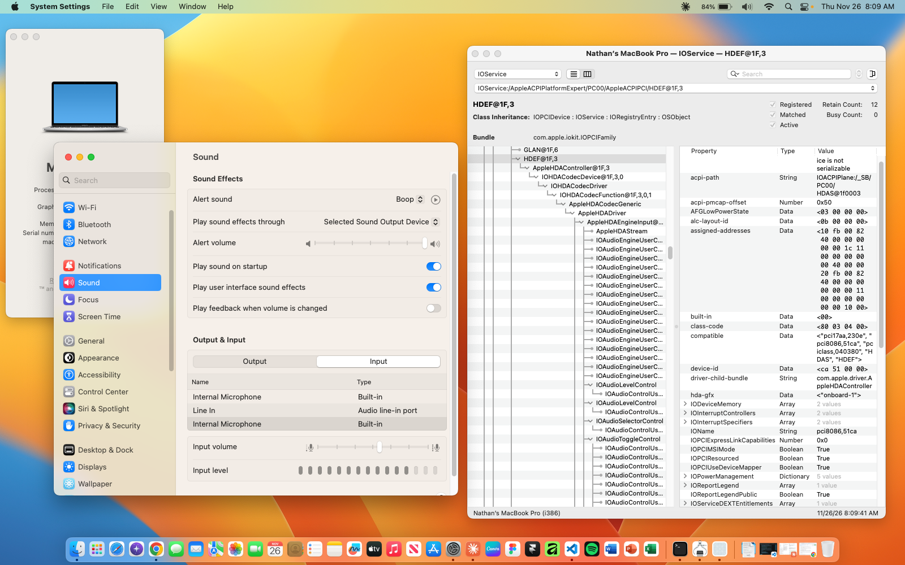

# Built-in microphone (DMIC) on macOS for Raptor Lake: ThinkPad T14 Gen 4

Working internal digital microphones on a hackintosh with an Intel **Raptor Lake-P** audio DSP
(`8086:51CA`), using **LatSOF-Audio**, a macOS kext that boots Intel's Sound Open Firmware (SOF) on
the audio DSP, the same way Linux does.

As far as I know, this is the first Raptor Lake machine reported working with LatSOF. Upstream was
verified on Comet Lake, with an early Tiger Lake report.

> Experimental. Kernel extension, community firmware loader, tested on one laptop. Keep a recovery
> path (see [Recovery](#recovery)) before you try it.

## Why the internal mic never works on these laptops

On most Intel laptops from about 2020 onward, the built-in microphones are **digital mics (DMIC)
wired to the Intel audio DSP**, not to the Realtek codec. AppleHDA and AppleALC only drive the
codec, so speakers and the headset jack work, but macOS never starts the DSP. No layout-id or
codec patch can reach those mics.

Linux handles them with Sound Open Firmware. LatSOF-Audio ports that boot path into a macOS kext and
publishes the mics as a normal macOS input device, while AppleHDA keeps the speakers and jack.

## Tested hardware

| | |
|---|---|
| Laptop | Lenovo ThinkPad T14 Gen 4 (Intel) |
| CPU | Intel Core i5-1345U (Raptor Lake-U) |
| Audio controller | Intel Raptor Lake-P/U/H cAVS, `8086:51CA` |
| Codec | Realtek ALC287 (AppleALC, layout-id 11) |
| Microphones | 2 DMICs (NHLT: 48 kHz, 2 channels, 16-bit) |
| DSP firmware | SOF 2.2.0, IPC3, `sof-rpl.ri` |
| macOS | Ventura 13.x (fill in your exact version), OpenCore 1.0.8 |


*Sound → Input with the built-in mic selected and the level meter moving. Right: the audio controller
`HDEF@1F,3` (`pci8086,51ca`) in IORegistryExplorer.*

## Status

| | |
|---|---|
| Kext loads, finds `8086:51CA` | ✅ |
| DSP firmware boots (`FW-Entered OK`, `FW-Ready OK`) | ✅ |
| IPC round trip | ✅ |
| Mic pipeline (`Topology 8 OK, 0 FAIL`) | ✅ |
| Input device published (ioreg: "LatSOF DMIC capture"), default input | ✅ |
| Recording (level meter, QuickTime / Voice Memos) | ✅ |
| Speakers/headphones while recording | ⚠️ not tested long-term (see [Known issues](#known-issues)) |
| Sleep / wake | ❓ not tested |
| Sonoma, Sequoia, Tahoe | ❓ not tested on this machine (upstream reports Sequoia and Tahoe on other chips) |

## Changes from upstream

Based on [macintelk/LatSOFAudio](https://github.com/macintelk/LatSOFAudio) (Tiger Lake fork of
[pokipoi/LatSOF-Audio](https://github.com/pokipoi/LatSOF-Audio)). Three changes:

1. **Controller ID:** `0x51CA` added to the controller match in `LatSOFAudioDevice.cpp`. Linux drives
   Raptor Lake-P with the Tiger Lake ops, so the existing cAVS 2.5 boot path is used unchanged.
2. **Firmware:** embeds `sof-rpl.ri` instead of `sof-tgl.ri` (`sof_firmware_embed.s`). Intel DSP
   firmware is signed per platform; use the file your own Linux install loads.
3. **macOS target:** built with `-mmacosx-version-min=13.0` (upstream uses 14.0) so it loads on Ventura.

Nothing else was changed. No board-specific topology edits were needed on this machine.

## Will it work on my laptop? Check under Linux first

Boot any Linux live USB (Ubuntu, Mint) and run:

```sh
lspci -nn | grep -i audio          # your controller ID
arecord -l                          # look for card "sof-hda-dsp" with a "DMIC" device
arecord -D plughw:0,6 -f S16_LE -r 48000 -c 2 -d 5 test.wav && aplay test.wav
sudo dmesg | grep -i -E "sof|ipc"   # firmware file and IPC type
```

Use the card and device numbers from `arecord -l`. You want:

- the DMIC recording works under Linux (if Linux can't record, macOS won't either)
- `ipc type 0` and a firmware path like `intel/sof/sof-rpl.ri` (IPC3, the protocol this kext speaks).
  A path under `intel/sof-ipc4/` means IPC4, which this kext does not support.

On this T14 the log shows:

```
sof-audio-pci-intel-tgl 0000:00:1f.3: DMICs detected in NHLT tables: 2
sof-audio-pci-intel-tgl 0000:00:1f.3: Firmware paths/files for ipc type 0:
sof-audio-pci-intel-tgl 0000:00:1f.3:  Firmware file:     intel/sof/sof-rpl.ri
sof-audio-pci-intel-tgl 0000:00:1f.3:  Topology file:     intel/sof-tplg/sof-hda-generic-2ch.tplg
```

Copy the firmware your Linux loads (`/lib/firmware/intel/sof/sof-rpl.ri*`, often `.zst`-compressed;
decompress it) for the build.

## Requirements

- OpenCore with `Kernel → Quirks → DisableIoMapper = true` (the DSP's DMA is dropped by VT-d otherwise)
- AppleALC working for the codec (speakers/jack)
- SIP and kext settings that allow third-party kexts in `/Library/Extensions`
  (this machine: `csr-active-config` `0x0A13`)

## Build

On macOS with Xcode or the Command Line Tools:

```sh
cd kext
cp /path/to/sof-rpl.ri LatSOFAudio/Firmware/sof-rpl.ri
zsh build.sh          # -> LatSOFAudio.kext and latsof-default-input
```

## Install

The kext depends on IOAudioFamily, so it must load from `/Library/Extensions`, not through OpenCore's
`Kernel → Add` (an OpenCore-injected copy is silently dropped).

**1. Copy it into place**

```sh
sudo zsh install.sh
```

**2. Rebuild the auxiliary kext collection** (on Ventura `kmutil install --volume` doesn't exist, and the
approval prompt may never appear for an ad-hoc-signed kext). This includes every kext in
`/Library/Extensions`, so existing ones (for example WhateverXe Graphics) stay included:

```sh
W=$(sudo mktemp -d /Library/KernelCollections/.latsof.XXXXXX)
A=(); for k in /Library/Extensions/*.kext; do A+=(-p "$k"); done
sudo kmutil create -n aux -x -z -V release -r /Library/Extensions --allow-missing-kdk "${A[@]}" \
  -B /System/Library/KernelCollections/BootKernelExtensions.kc \
  -S /System/Library/KernelCollections/SystemKernelExtensions.kc \
  -A "$W/AuxiliaryKernelExtensions.kc" --no-authentication \
&& sudo chmod 0644 "$W/AuxiliaryKernelExtensions.kc" \
&& sudo mv -f "$W/AuxiliaryKernelExtensions.kc" /Library/KernelCollections/AuxiliaryKernelExtensions.kc \
&& echo "AuxKC updated"
sudo rm -rf "$W"
```

Only reboot if it prints `AuxKC updated`.

**3. Optional: make it the default input at login**

```sh
cd latsof-default-input && zsh install.sh
```

## Verify

```sh
kmutil showloaded --list-only | grep -i latsof
ioreg -lw0 -r -c LatSOFAudioDevice | grep -i -E '"Status"|IPC-Test|Topology|FW-Ready'
```

Expected:

```
"Status" = "OK"
"FW-Ready" = "OK"
"IPC-Test" = "ROUND-TRIP OK ..."
"Topology" = "8 OK, 0 FAIL"
```

Then pick the mic in System Settings → Sound → Input. macOS lists it as an **Internal Microphone**
entry (the kext's engine is described as "LatSOF DMIC capture" in ioreg); AppleHDA's own codec mic
entry may appear as a second "Internal Microphone". Pick the one whose level meter moves when you talk. Apps need microphone permission;
if an app records silence, quit it with ⌘Q and reopen it (permission is checked at launch).

## Known issues

- The log can show `SD7 still programmed after 20 rounds; borrowing anyway (playback may glitch)`.
  The kext borrows one of AppleHDA's output DMA engines to load the firmware. No playback problems
  seen so far, but this hasn't been tested over long sessions.
- The `latsof-default-input` helper is ad-hoc signed; macOS logs an AMFI warning for it but runs it.

## Recovery

- **Stop it on a running system:** `sudo sysctl -w kern.latsof_lab="auto=0"`
- **Disable at boot:** boot-arg `latsof-auto=0`
- **Boot without it:** hold **Shift** in the OpenCore picker (Safe Mode skips `/Library/Extensions`),
  then `sudo zsh install.sh --remove` and rebuild the auxiliary collection (step 2 above).

## Credits

- [pokipoi/LatSOF-Audio](https://github.com/pokipoi/LatSOF-Audio): the macOS SOF DMIC driver
- [macintelk/LatSOFAudio](https://github.com/macintelk/LatSOFAudio) (jalavoui): Tiger Lake fork this port is based on
- [DexterSLamb/CmlSOFAudio](https://github.com/DexterSLamb/CmlSOFAudio): original Comet Lake work
- [Sound Open Firmware](https://github.com/thesofproject) and the Linux SOF driver
- [b00t0x/WhateverXe](https://github.com/b00t0x/WhateverXe) for graphics on this machine

## License

Kext: MIT (see `LICENSE`). SOF firmware: BSD-3-Clause / GPL-2.0 (see `LICENSE.sof`).
